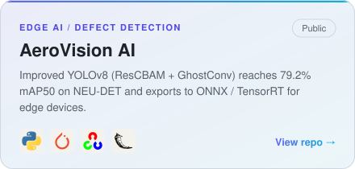
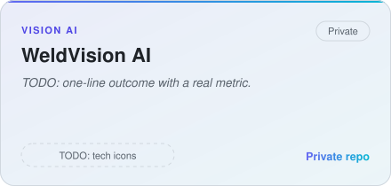
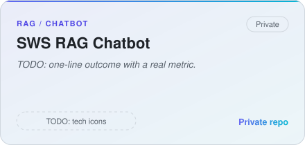
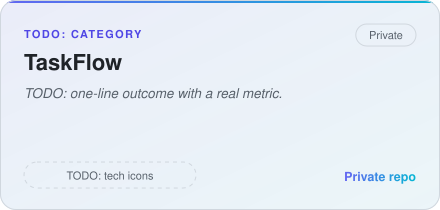
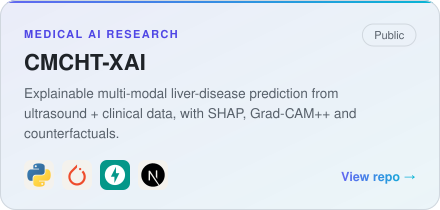
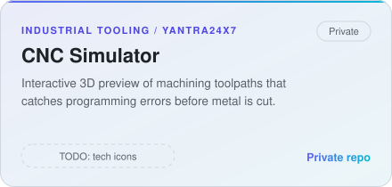
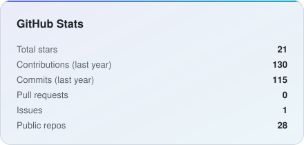
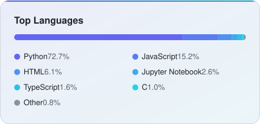
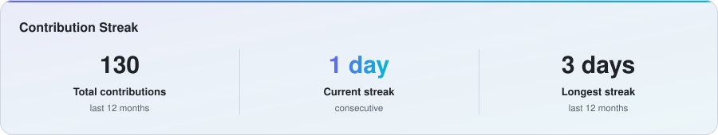

<picture>
  <source media="(prefers-color-scheme: dark)" srcset="./assets/header-dark.svg">
  
</picture>

**I build production AI (LLM agents, RAG and edge computer vision) and the full-stack apps that put it in front of real users. My LMS serves 1,000+ people.**

## About

- **AI & Full-Stack Engineer**: B.Tech AI & Data Science, Sri Krishna College of Technology, Coimbatore (2023 to 2027).
- **Now:** AI/ML Developer Intern at Yantra24X7, building industrial vision and CNC tooling.
- **Before:** Software Developer at PineSphere Solutions (May 2025 to May 2026), where I shipped 3+ production web and mobile apps with zero-downtime CI/CD.
- **Focus:** grounded LLM systems, with evals in CI, retrieval before generation, and models that work on the edge. Microsoft Certified: Azure Fundamentals.

## Tech Stack

<table align="center">
  <tr><td><b>Languages</b></td><td></td></tr>
  <tr><td><b>Backend</b></td><td></td></tr>
  <tr><td><b>Frontend / Mobile</b></td><td></td></tr>
  <tr><td><b>AI / ML</b></td><td> 
    
    
    
    </td></tr>
  <tr><td><b>Cloud / DevOps</b></td><td></td></tr>
</table>

## Featured Projects

<table>
  <tr>
    <td width="50%"><a href="https://github.com/MUGESH-KUMAR-M/AeroVision-AI"><picture>
      <source media="(prefers-color-scheme: dark)" srcset="./assets/cards/aerovision-dark.svg">
      </picture></a></td>
    <td width="50%"><a href="https://mugeshkumar.com/"><picture>
      <source media="(prefers-color-scheme: dark)" srcset="./assets/cards/weldvision-dark.svg">
      </picture></a></td>
  </tr>
  <tr>
    <td width="50%"><a href="https://mugeshkumar.com/"><picture>
      <source media="(prefers-color-scheme: dark)" srcset="./assets/cards/sws-rag-dark.svg">
      </picture></a></td>
    <td width="50%"><a href="https://mugeshkumar.com/"><picture>
      <source media="(prefers-color-scheme: dark)" srcset="./assets/cards/taskflow-dark.svg">
      </picture></a></td>
  </tr>
  <tr>
    <td width="50%"><a href="https://github.com/MUGESH-KUMAR-M/Hybrid-Multi-Modal-Framework-for-Effective-Prediction-of-Liver-Diseases"><picture>
      <source media="(prefers-color-scheme: dark)" srcset="./assets/cards/cmcht-xai-dark.svg">
      </picture></a></td>
    <td width="50%"><a href="https://mugeshkumar.com/"><picture>
      <source media="(prefers-color-scheme: dark)" srcset="./assets/cards/cnc-sim-dark.svg">
      </picture></a></td>
  </tr>
</table>

## GitHub Stats

<picture>
  <source media="(prefers-color-scheme: dark)" srcset="https://raw.githubusercontent.com/MUGESH-KUMAR-M/MUGESH-KUMAR-M/stats/stats-dark.svg">
  
</picture>
<picture>
  <source media="(prefers-color-scheme: dark)" srcset="https://raw.githubusercontent.com/MUGESH-KUMAR-M/MUGESH-KUMAR-M/stats/langs-dark.svg">
  
</picture>
<picture>
  <source media="(prefers-color-scheme: dark)" srcset="https://raw.githubusercontent.com/MUGESH-KUMAR-M/MUGESH-KUMAR-M/stats/streak-dark.svg">
  
</picture>

<picture>
  <source media="(prefers-color-scheme: dark)" srcset="https://raw.githubusercontent.com/MUGESH-KUMAR-M/MUGESH-KUMAR-M/output/snake-dark.svg">
  
</picture>

## Contact

Hiring for LLM, GenAI or full-stack AI work? Email is the fastest way to reach me.

